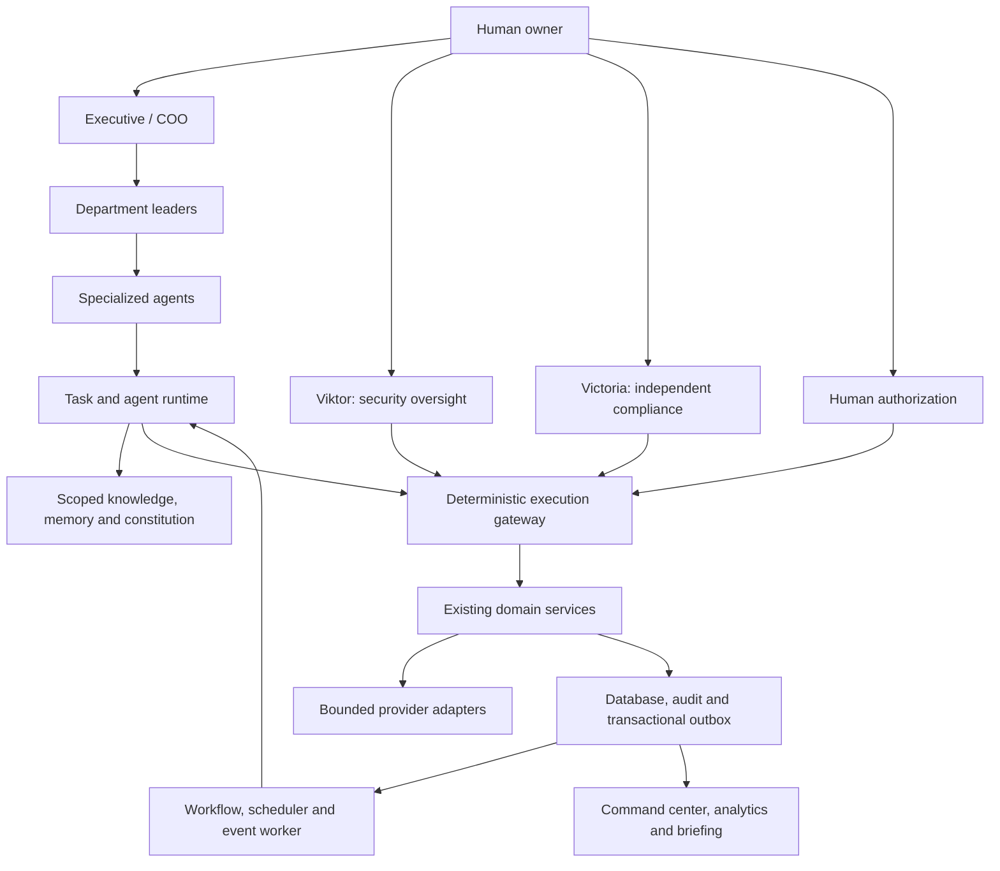

# Broken Arrow AI — target architecture

Status: proposed incremental architecture, 2026-10-04. The implementation inventory and evidence are in ARCHITECTURE_AUDIT.md. This design extends the current application; it does not replace existing agents, routes, tables, business workflows or human controls.

## 1. Architectural decisions

Keep a modular monolith on Node 24 and native TypeScript while extracting explicit services from the existing route/controller layer. Keep SQLite for the single-host local pilot. Introduce repositories and transaction boundaries that can later support PostgreSQL; require that migration before multi-instance hosted execution. Keep the current frontend and hash navigation, adding feature modules and paginated endpoints. A framework migration is a separate justified decision, not a prerequisite for this expansion.

The organization has two distinct layers: role-based planning and deterministic authority. A role or model can propose work; only the application can authenticate a principal, resolve permissions, reserve a budget, consume approval and dispatch a tool. Constitutional text guides model behavior, but code enforces non-negotiable constraints.

## 2. Identity, registry and constitution

`agents` remains the stable identity table. Introduce immutable `agent_config_versions` and an active version pointer, retaining legacy `definition` as a compatibility projection until existing readers migrate. Preserve IDs, names, responsibilities and independent oversight reporting. Default new capabilities to disabled; migration must not turn declared tools into active execution grants.

A normalized `agent_relationships` graph records same-company supervisor/subordinate relationships. Validate a single primary supervisor, no self-edges, no cycles and bounded delegation depth. Executive and oversight relationships are explicit. Cross-department handoff requires a configured workflow route, approved communication grant or escalation through supervisors; a message alone cannot grant authority.

Versioned `constitution_versions` hold rules separately from agent prompts. The active version is pinned into each execution snapshot alongside the agent, workflow and policy versions. A human-only change proposal records diff, evidence, effective date and audit. Code-level prohibitions on self-escalation, secret disclosure, agent authorization and audit deletion cannot be overridden by constitutional prose.

Recommended initial rules are the 20 principles supplied by the owner. Preserve the stronger existing rule that agents never approve actions. Agents may issue QA verdicts or recommendations, while execution authorization remains a persisted human decision.

## 3. Service architecture and ownership

| Service | Ownership and existing code to reuse |
| --- | --- |
| AgentRegistryService | Stable identities and queries over `agents`/`departments`; role routing and legacy definition projection |
| AgentConfigurationService | Version proposals, human activation/rollback, model and context configuration; no self-edit endpoint |
| ConstitutionService | Versioned rules and effective policy snapshots |
| AuthorityService | Reporting graph, cycle checks, delegation and cross-department authority |
| AgentPermissionService | Resource/action/environment grants and effective permissions; adapt `policy.ts`, compliance and Viktor checks |
| TaskService | Extend existing `tasks` and dependencies; lifecycle, parent tree, inputs/outputs and completion criteria |
| CommunicationService | Structured envelopes linked to tasks/workflows; preserve existing CEO chat |
| WorkflowService | Immutable templates, pinned run versions, step dependencies/branches, pause/cancel/review |
| SchedulerService | Extend existing bounded schedules, calendar recurrence and event triggers; central due-work acquisition |
| EventService | Transactional outbox, scoped subscriptions, idempotent delivery and dead letters |
| AgentRuntimeService | Execution contract, context preparation, typed provider call, validated result and failure classification |
| ExecutionGateway | Authoritative tool catalog, permissions, stop/hold/lockdown, approval, cost reservation, dispatch and reconciliation |
| KnowledgeService / MemoryService | Separate reusable knowledge from historical experience; retain source/review/withdrawal lineage |
| DecisionService | Evidence-linked decision versions, actual results and review dates |
| ApprovalService / QAService | Shared envelopes over existing domain approval/QA implementations; no immediate destructive consolidation |
| CostService / ObservabilityService | Usage and budget ledgers, attempts, correlation, worker health and safe diagnostics |
| NotificationService / BriefingService | In-app delivery first; verified operational read models and actionable human summaries |

Existing ResearchService, DesignService, ProductService, MarketingService, CustomerService, TechnologyService, OperationsService, ComplianceService and LearningService remain domain authorities. Generic orchestration calls them; it does not bypass or duplicate their validation. Viktor remains an oversight service, not an unrestricted tool dispatcher.

## 4. Proposed data changes

Migration names below describe scope; final sequence numbers must be allocated after confirming which Viktor migrations have already been applied. Do not edit or renumber an applied migration. Initial next available number in this working tree is 019.

| Increment | Additive schema proposal | Compatibility strategy |
| --- | --- | --- |
| Registry/constitution | Agent config versions, relationship graph, constitution versions, human change proposals | Backfill current JSON definitions/names; preserve current readers through projection |
| Tasks/communication | Task metadata extension, parent links, attempts, execution outputs, communication messages and references | Keep task IDs/status values initially; map legacy COMPLETE/WORKING labels through an adapter |
| Workflow/events | Template versions, runs, step runs, outbox, delivery receipts, dead letters, schedule extensions | Keep current eight automation kinds and their run history; dispatch existing services |
| Knowledge/memory | Collections, item versions, scoped memberships and source links; memory provenance extensions | Link legacy research/memory records without silently reclassifying them as trusted knowledge |
| Policy/QA | Grant resources, policy versions, shared authorization references, QA result envelopes | Retain existing exact-content approval tables until parity and migration are demonstrated |
| Operations/cost | Usage ledger, budget reservations, operation receipts, correlations and health snapshots | Import only observed costs; do not treat reservations as spend |
| Decisions/learning | Decision versions, evidence joins, outcome reviews and improvement proposals | Connect experiments, organization reports and learning cycles instead of copying outputs |

All owned records have `company_id`, same-company foreign keys, UTC timestamps, constrained states and indexes for queue/retrieval access. Version bodies and execution evidence are immutable; mutable pointers/status records are separate. Currency values use integer minor units with currency. Unknown costs, tokens and confidence remain null/unavailable.

Public IDs are opaque identifiers, never authorization. Use composite references for tenant-owned artifacts. Outbox/receipt deduplication keys include tenant and logical operation identity. Store secret references only; no model inputs/outputs, tool traces or event payloads may include secret material.

## 5. Execution and workflow contract

1. Receive a task under an authenticated human or verified workload identity. A body-supplied agent ID is not identity.
2. Resolve the task, actor, supervisor and pinned configuration in the company scope.
3. Evaluate constitution, grants, risk, autonomy, company/department/agent/workflow stops, compliance and security.
4. Assemble bounded task context from authorized knowledge, memory, messages and evidence. Treat source content as untrusted data.
5. Resolve tools from a server-owned catalog with fixed input/output schemas, effects, costs and credential destinations.
6. Atomically claim the attempt/lease and reserve any authorized budget. Do not hold a SQLite transaction across network calls.
7. Call the selected provider or simulation adapter outside the transaction with deadline and logical-operation idempotency key.
8. Validate output against the task contract; reject unsupported completion claims and unsafe instructions.
9. Persist output/evidence, usage, status, audit and outbox events in one transaction. External effects require a provider receipt or reconciliation state.
10. Apply mandatory QA and human authorization before consequential downstream steps.
11. Promote only eligible, reviewed lessons to memory; emit results and update read models.

Standard structured outputs contain task/agent IDs, status, summary, deliverables, evidence/source references, assumptions, risks, confidence, next actions and approval needs. These fields must be validated; confidence alone cannot validate a claim.

Workflow steps are versioned data: role, bounded inputs, output contract, dependencies, approved branch expressions, deadline, retry policy, QA and approval gates. Do not evaluate arbitrary JavaScript, SQL or model-supplied code. “Parallel” initially means independent durable steps, not unsafe parallel access to the same synchronous transaction. Paid/external work uses separate claims and bounded concurrency.

Retries distinguish transient read failures from permission, validation, QA and uncertain external effects. No automatic repeat of an uncertain charge, publish or product write. Bounded retries, backoff, operation receipts and escalation prevent runaway loops. Cancellations stop future dispatch; already accepted external effects require reconciliation.

## 6. Knowledge, memory and context

Knowledge answers “what reusable information is available?” Memory answers “what happened and what did we learn?” Preserve separate services and retrieval policies, even where legacy records share storage.

Collections support global, department, agent, project and approved external scopes. Search first applies tenant/category/role permissions and source validity, then relevance ranking. Begin with indexed text/FTS when useful; embeddings are optional and require provider authorization, cost controls and privacy review. Never use a global vector search followed by tenant filtering.

Context snapshots record source IDs/versions and bounded excerpts, not the full company state. Prioritize constitution, role, task, approved workflow state, fresh relevant evidence, recent messages and tool results. Treat withdrawn, superseded or expired evidence explicitly. Derived lessons must preserve uncertainty and never turn correlation into causation.

## 7. Frontend architecture

Retain the current shell, branding, hash routes and existing pages. Add feature modules using the current pattern, keeping business decisions in server services. Introduce shared rendering/forms/loading/error utilities where duplication is demonstrated, without rewriting the UI.

Add or extend:

- Organization: reporting graph, role profiles, read-only current configuration and human change/version review.
- Constitution: current rules, history and human-only version proposal/activation.
- Tasks: parent/dependency tree, workflow linkage, attempts, QA and authorization history.
- Workflows: template/run details, branch decisions, blocked steps and pause/cancel controls.
- Knowledge/Memory: separate navigation, scoped search, evidence and review status.
- Decisions: options, reasoning summary, evidence, outcome and review date.
- Command center: company → department → agent → task → execution drill-down; missing metrics shown honestly.
- Security: complete Viktor’s unfinished dashboard, session management and monitoring coverage before claiming it exists.

Move from the expanding all-data `/api/state` response toward paginated feature reads while preserving legacy API behavior until consumers migrate. Keep security metadata out of model context and routine analytics. Render text safely, retain CSP, provide accessible labels, keyboard operation and visible simulation/approval/stop states.

## 8. Autonomy, costs and control

Autonomy levels 0–4 are evaluated per action and environment. They do not override risk, grant absence, QA, human approval, budget or emergency controls. Start migrated agents at their current effective capability, not a higher level suggested by a role title. Levels 3–4 remain unavailable for tools without validated worker, provider and reconciliation support.

Enforcement order is explicit: invalid identity/tenant → deny; security/compliance veto or stop → deny ordinary work; missing grant → deny; budget/QA/input failure → block; required human authorization absent → wait; eligible action → dispatch. Defensive read/revoke/cancel paths use a narrow audited exception list. Releasing a security hold never automatically resumes revoked schedules or approvals.

Cost records distinguish reserved, estimated, reported and reconciled actual charges. Track model/tool usage only when observed. Warn before limits and prevent additional unauthorized reservations when hard limits are reached. Actual remote billing can differ from estimates; in-flight cost cannot be undone by emergency stop.

## 9. Stack-specific changes to requirements

- Use deterministic local services and bounded workers before distributed agents or microservices.
- Keep SQLite locally; move to PostgreSQL for hosted multi-instance queues and tenant scaling, not merely to add registry fields.
- Keep human execution approval. Agent QA is a review result, not authority to spend, publish or change credentials.
- Use calendar-aware UTC/timezone schedules for monthly/cron behavior; do not approximate months as a fixed number of hours.
- General role routing must preserve specialist business validation and current IDs/names.
- Encrypted backups are inspection copies until a tested failover process revokes/reconciles old authority. Do not automatically roll back databases containing external-action history.
- Vault choice/configuration and live integration acceptance are separate operational dependencies. Adapter code is not an activated service.
- Do not expose model-generated self-modification. Improvements enter immutable, evidence-backed human change proposals.

## 10. Release strategy

Every milestone has a schema migration/backfill test, service/HTTP negative tests, applicable frontend verification, full regression run and documented capability limits. Use simulation and mocks for side effects. No cloud resources, live spending, publishing or credential changes follow automatically from this architecture.

Establish a version-controlled baseline, repair the known Viktor boundary issues, then implement the ordered roadmap. Production requires the existing HARDENING.md gates plus successful runtime, workload identity, policy-convergence and realistic load/security acceptance. The final system must remain useful and safe when all model providers are unavailable.
